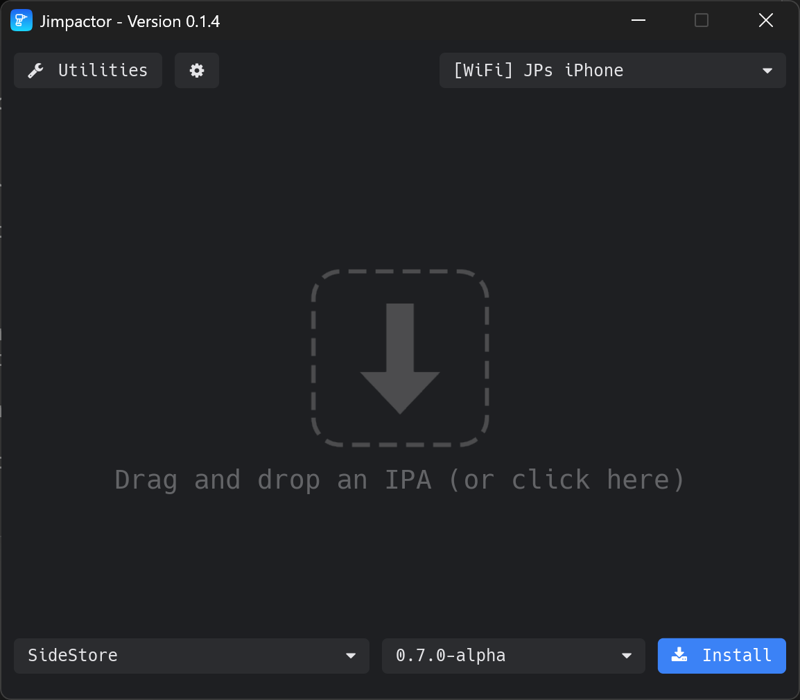

# Jimpactor

Jimpactor is an independently maintained iOS sideloading app for Windows, macOS, and Linux.



**This project is not affiliated with, endorsed by, or maintained by the original PlumeImpactor / Impactor project or its authors.** It is a separate fork of [PlumeImpactor, now Impactor](https://github.com/claration/Impactor). Upstream code and contributors are credited in [Attributions.md](Attributions.md).

Report Jimpactor issues and request features in [this repository](https://github.com/jpdagostin0/jimpactor/issues).

## Features

- Sign and sideload iOS apps using your Apple Account, with GUI and CLI interfaces.
- Refresh installed apps from the system tray.
- Discover paired iPhones and iPads over Wi-Fi and install or refresh apps wirelessly.
- Reach devices over Tailscale from anywhere, without installing Tailscale on the computer.
- Enable JIT for apps on iOS 17+ through a built-in JIT server.
- Choose local or remote anisette providers, including custom servers and Sideloadly connections.
- Browse app sources and install release IPAs.
- Export signing certificates and generate or install device pairing files.
- Manage accounts, developer teams, registered devices, app identifiers, and logs.
- Customize apps and inject supported tweaks and frameworks.

Jimpactor can supply pairing files to apps such as StikDebug, and its JIT server can enable JIT directly.

## Downloads

Use artifacts published under [Jimpactor releases](https://github.com/jpdagostin0/jimpactor/releases), when available, or build from source. The original project's releases, Homebrew cask, and Flathub listing distribute the original project.

## Connect your device

On Windows, install Apple's device drivers through [iTunes](https://support.apple.com/en-us/106372). On Linux, install and run `usbmuxd` before connecting your device.

Pair your iPhone or iPad with this computer over USB first and accept **Trust This Computer** on the device. For wireless connections, keep the computer and device on the same Wi-Fi network. Jimpactor automatically discovers paired devices; select the entry labeled `[WiFi]` in the device dropdown to install or refresh apps and manage pairing files wirelessly.

Wi-Fi devices stay in the list for five minutes after disconnecting. Jimpactor reconnects automatically when a device returns, preserving your selection. Before starting a device operation, it waits briefly for a cached device to reconnect. If the device is unavailable, wake and unlock it, check its Wi-Fi connection, and retry.

## Signing and troubleshooting

For Apple IDs with multiple developer teams, choose a team in **Settings → Account** before signing or exporting a certificate. In CLI scripts, pass the team explicitly:

```sh
jimpactor-cli sign --apple-id --team-id TEAM_ID --package App.ipa --output Signed.ipa
```

Use the device's full UDID with `--udid`; the number assigned to a USB connection changes when it reconnects. Reinstalling an app with another account updates its device's Auto Refresh account after installation succeeds.

Before signing an app for a device, Jimpactor checks that Developer Mode is on. If it is off, Jimpactor reveals the switch in **Settings → Privacy & Security → Developer Mode** and stops so you can turn it on. For apps that use pairing files, such as SideStore and StikDebug, it also confirms the device trusts this computer. After installation it places the pairing file and reads it back to verify it. SideStore also receives an RPPairing record when the device supports one, even with remote pairing off; otherwise it gets the lockdown record.

Jimpactor checks provisioning profiles against the app and destination device before installation. If a profile or certificate has expired, does not match, or has been revoked, re-sign with a valid identity and a profile that includes your device. A CoreTrust-patched executable with data after its signature cannot be re-signed; use an original decrypted IPA.

Apple verification errors distinguish an incorrect code from a temporary lockout or service failure. Wait before retrying a locked challenge. For anisette connection errors, check the selected server in Settings and your system's proxy and certificate settings.

Startup errors are written to the `logs` folder in the application data directory below. If Windows exits with a native access violation, include the Event Viewer faulting module and exception code with your report.

## Export and tweak options

Choose **Modify without signing** to apply app customizations and export an IPA without replacing executable signatures. Modified apps generally need signing before installation. **No Modify** keeps its existing behavior and skips customizations.

URL schemes can be replaced with a comma-separated list or removed in the app options. For tweaks, choose **ElleKit** (the default) or **None** for libraries that provide their own hooking. The library folder is relative to the app: leave it blank for the existing `Frameworks` placement, or enter `/` for the app root. Load paths support `@rpath` and `@executable_path`.

```sh
jimpactor-cli sign --package App.ipa --output Modified.ipa --modify-only --url-scheme duplicate-app
jimpactor-cli sign --package App.ipa --output Signed.ipa --tweaks Custom.dylib --tweak-loader none --tweak-inject-folder / --tweak-inject-path @executable_path
```

## Device controls

Turn on **Settings → Behavior → Lock installs to a selected device** to tie installations to one device's UDID. Choosing a device in the picker then only previews it; press **Select** beside the picker to make it the target. The choice is kept across restarts. If the device disconnects, installation stays disabled until it returns or you select another device. Export remains available.

**Close to tray** (on by default) keeps Jimpactor running in the tray when the window closes so Auto Refresh continues. When it is off, closing the window quits, unless an installation or refresh is running.

**Utilities** lists sideloaded apps with their icons and profile expiration dates. Apps without a readable provisioning profile, such as App Store apps, are not listed. Pairing actions are available for supported apps.

## Tailscale

**Settings → Tailscale** joins your tailnet from inside Jimpactor using the embedded tailscale-rs library, so Tailscale does not need to be installed on the computer. Turn on **Connect to Tailscale**, then press **Sign In** to approve the computer, or enter an auth key. A custom coordination server such as Headscale is supported. Install Tailscale on the iPhone, sign in to the same tailnet, and pair the iPhone with the computer over USB once. Then add the iPhone's machine name or `100.x.y.z` address under **Devices**; it appears in the device picker as `[Tailscale]`.

tailscale-rs is experimental. It cannot list tailnet peers yet, so devices must be entered by name or address, and traffic may be relayed through Tailscale's DERP servers, so large installations can be slower than on Wi-Fi. It is not available on Intel Macs.

## JIT server

**Settings → JIT Server** runs an HTTP server that enables JIT for apps on connected devices running iOS 17 or later with Developer Mode on. It accepts connections from this computer only, the local network, or the tailnet. The developer disk image is downloaded once and mounted when needed.

| Request | Result |
|---|---|
| `GET /` | Connected devices |
| `GET /{udid}` | Installed apps |
| `GET /{udid}/{bundle_id}` | Launch the app with JIT enabled |
| `GET /{udid}/attach/{pid}` | Enable JIT for a running process |

The server has no password; anyone who can reach it can launch apps on connected devices.

In **Settings → Developer**, registered devices can be enabled or disabled when your Apple account permits it. Apple does not offer ordinary permanent deletion: disabling requires Account Holder or Admin access, invalidates profiles containing that device, and does not free an annual device slot. See [Apple's device-management rules](https://developer.apple.com/help/account/devices/disable-or-enable-a-device/).

## Running another version

When another Jimpactor version is already running, launching a different version shows both versions and lets you restart into the newly launched executable, continue using the running version, or cancel. Finish installations and refreshes first; an active operation prevents restart.

Older builds cannot report their version or accept a restart request. For the first upgrade from one of those builds, quit Jimpactor from its tray menu and open the new executable again.

## Build

Install Rust, CMake, and the native dependencies listed in the [contributing guide](.github/CONTRIBUTING.md).

```sh
# GUI
cargo run --locked --bin jimpactor

# CLI
cargo run --locked -p jimpactor-cli -- --help

# Release binaries and platform packages in dist/
cargo xtask dist

# Cross-compile and package macOS on Linux or Windows (requires Zig and Cargo tools)
cargo xtask dist --target universal2-apple-darwin
```

The workspace contains the GUI in `src/impactor`, the CLI in `src/cli`, shared libraries in `crates`, and build tools in `tools`. All platform icons are generated from `package/icon.svg`.

## Application data

Jimpactor uses its own application identifier, `io.github.jpdagostin0.jimpactor`, and stores configuration in `%APPDATA%/Jimpactor` on Windows or `${XDG_CONFIG_HOME:-$HOME/.config}/Jimpactor` on macOS and Linux. GUI and CLI share this directory. Account tokens use the `Jimpactor` service in the OS credential store when available.

Earlier development builds used the original project's `PlumeImpactor` directory and credential-store name. Sign in and configure Jimpactor again when moving from one of those builds; the original project's data is left in place.

## License and credits

Jimpactor is by JP D'Agostino and is licensed under the [MIT license](LICENSE). The original project's license notice is preserved in [Attributions.md](Attributions.md). Some components use other licenses, including MPL-2.0 and Apache-2.0; see their individual license files.
